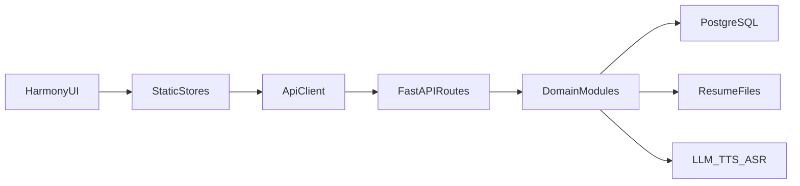
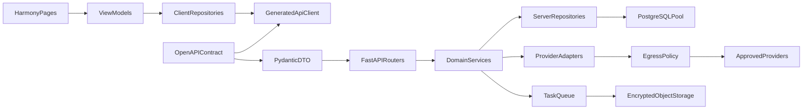

# 鸿蒙客户端与服务端联合代码审计报告

> 审计对象：
>
> - `D:\work\ali-agent-interview-harmony`
> - `D:\work\ali-agent-interview-server`
>
> 审计日期：2026-09-04  
> 审计方式：静态只读审计、跨端接口对照、关键安全链路复核  
> 目标读者：项目负责人、客户端与服务端研发、测试及运维

## 1. 执行摘要

当前版本具备较完整的产品功能和清晰的基础目录分层，题库、点评、语音、进度、简历和模拟面试等主链路基本贯通。但从生产发布标准看，认证模型、安全边界、工程治理和自动化质量保障仍有明显缺口。

综合成熟度评估：**4.5 / 10，适合作为功能验证版，不建议在修复 P0 风险前直接公开部署。**

分项评估：

- 项目结构：6 / 10。目录边界清楚，但两个项目尚未被 Git 跟踪；服务端路由层和客户端页面逐渐单体化。
- 代码质量：5 / 10。核心流程可读，但存在同步 I/O 阻塞、静默异常、手动刷新和资源生命周期问题。
- 命名一致性：6.5 / 10。跨端 JSON 基本统一为 camelCase，局部命名与实际语义不符。
- 可扩展性：4 / 10。缺少可执行数据库迁移、共享 API 契约、依赖注入和细粒度状态模型。
- 跨端契约：5 / 10。当前核心路由基本对齐，但依赖双方手写，缺乏版本和兼容性治理。
- 安全与隐私：3 / 10。存在 SSRF、设备 UUID 免密接管、匿名消耗服务端模型配额、明文凭证和简历默认明文落盘。
- 测试与工程化：3 / 10。服务端已有部分测试，鸿蒙端无测试，双方均缺少 CI、契约测试和覆盖率门禁。

发布前安全门槛共五项：

1. 封堵服务端 BYOK `baseUrl` SSRF。
2. 取消设备 UUID 作为正式账号免密凭据。
3. 关闭匿名使用服务端 LLM Key，并修复可伪造来源 IP 的限流。
4. Release 禁止全局明文 HTTP。
5. 生产环境强制加密简历文件。

客户端凭证安全存储、数据库迁移和版本控制属于紧随其后的 P1 门槛，不与远程可利用的安全 P0 合并计算。

## 2. 审计范围与限制

### 2.1 已覆盖内容

- 鸿蒙端全部 27 个 `entry/src/main/ets/**/*.ets` 源文件。
- 鸿蒙端应用、模块、权限、网络安全、构建和依赖配置。
- 服务端入口、全部 API 路由及 23 个主要 Python 模块。
- 服务端认证、题库、点评、语音、简历、模拟面试、数据库和管理后台。
- 鸿蒙端 API 调用与服务端路由、请求、响应、鉴权和错误体的逐项对照。
- README、Docker、依赖、测试和仓库边界。

### 2.2 未执行或无法确认的内容

- 未连接生产 PostgreSQL，未验证生产 Schema 和数据质量。
- 未访问 `https://www.xiaoyangtx.cloud`，未验证 Nginx、TLS、WAF、超时和上传限制。
- 未运行 HarmonyOS 真机测试，麦克风、Speech Kit、后台行为和性能仍需设备验证。
- 未取得生产环境变量，无法确认是否配置 `RESUME_FILE_KEY`、`LLM_API_KEY` 和受信代理。
- 未对网页端仓库进行审计。
- 本次文档生成不修改业务代码。

### 2.3 其他审计维度覆盖状态

- Session 生命周期：已审计签发、校验和撤销代码；未验证生产清理任务、会话数量和数据库增长。
- 数据保留与删除：已确认简历存储路径和可选加密；未发现完整的数据保留期限、用户删除、备份清除和合规流程。
- 文件上传与解析：已审计扩展名、MIME 和大小检查；未执行恶意 PDF/DOCX、压缩炸弹和解析器沙箱测试。
- 密钥管理：已审计环境变量与客户端存储方式；未验证生产 KMS、轮换、权限分离和泄露响应。
- 依赖安全：已审计版本声明和锁定方式；未运行在线漏洞数据库扫描，因此不对具体 CVE 作结论。
- 备份恢复：代码仓库未呈现数据库和简历文件的备份恢复方案，未执行灾备演练。
- 管理后台：已审计 Token 校验和前端输出方式；未执行浏览器动态 XSS 验证。
- 可观测性：已检查日志、指标和健康检查代码；未连接生产日志或监控平台。

风险等级定义：

- **P0**：可被远程攻击者利用或利用前提较弱，并可能导致账号接管、大范围敏感数据泄露、内网攻击、显著成本滥用，或直接阻断生产部署。
- **P1**：影响较高但需要本地高权限、设备数据读取等较强利用前提；或高概率造成稳定性、数据一致性、资源泄漏以及部署、回滚和持续交付失控。
- **P2**：影响可维护性、扩展效率和局部体验，应纳入近期迭代。
- **P3**：规范、文档和长期工程质量建议。

## 3. 当前架构

### 3.1 鸿蒙客户端

鸿蒙端是单 `entry` HAP 模块，主要分层如下：

```text
entry/src/main/ets/
├── entryability/   应用启动与生命周期
├── pages/          Index、题库、模拟、听记
├── components/     题卡、点评、设置、简历档案
├── store/          Auth、Bank、Home、LLM、Progress、Resume
├── network/        统一 HTTP 客户端
├── model/          类型与 JSON 解析
├── speech/         TTS、ASR
├── common/         配置、Preferences、Context
└── utils/          题目树和 WAV
```

状态管理采用“静态单例 Store + 手动 `subscribe/emit` + 页面 `tick++`”模式。该方案在小规模下直接，但没有订阅生命周期、依赖注入和细粒度刷新能力。

### 3.2 服务端

服务端以 FastAPI + PostgreSQL 为主，Node/TypeScript 仅用于离线展开题库：

```text
server/
├── app.py              路由注册与部分业务编排
├── auth.py             用户、设备、Session
├── bank.py             题库与缓存
├── progress_sync.py    进度同步
├── recommend.py        首页推荐
├── judge.py            点评 Prompt 和响应归一化
├── tts.py              语音合成
├── transcribe.py       语音识别
├── resumes.py          简历档案持久化
├── resume_parse.py     简历解析
├── resume_mock.py      按简历模拟面试
├── admin.py            题库中台
└── db.py               PostgreSQL 连接
```

`server/app.py` 当前包含 30 余个路由、限流实例、输入解析、上游调用和静态文件挂载，已经形成偏重的路由入口。

### 3.3 主要跨端数据流



主业务协议为 HTTP JSON；`/api/tts` 返回二进制音频，`/api/transcribe` 和简历上传使用 multipart。当前无 WebSocket 或 SSE。

## 4. P0 风险

### P0-1：BYOK `baseUrl` 导致服务端 SSRF

**结论：已由静态调用链确认。**

当 `/api/judge`、`/api/tts` 或 `/api/transcribe` 请求携带任意非空 `apiKey` 时，调用方可同时指定 `baseUrl`。服务端随后使用共享 HTTP 客户端访问该地址，且允许跟随重定向。

利用前提：

- 相关接口可被攻击者访问。
- 服务端允许向目标内网、link-local 或攻击者控制的地址发起出站连接。
- 攻击者在请求中提供任意非空 `apiKey` 和恶意 `baseUrl`；该 Key 不需要真实有效。
- 具体影响取决于部署网络中可达的内部服务和云元数据防护。

证据：

- [`server/app.py`](../server/app.py) 第 381–408 行：从请求体读取 `apiKey` 和 `baseUrl`，随后调用 `http().post(...)`。
- [`server/app.py`](../server/app.py) 第 461–477 行：TTS 使用相同 BYOK 地址选择逻辑。
- [`server/app.py`](../server/app.py) 第 501–516 行：ASR 从 multipart 读取 `baseUrl`。
- [`server/http_client.py`](../server/http_client.py) 第 8–12 行：`httpx.Client(timeout=60.0, follow_redirects=True)`。
- [`server/tts.py`](../server/tts.py) 第 141–154、184–185 行：TTS 还能根据上游响应中的 URL 发起二次 GET。

影响：

- 探测或调用 VPC 内部 HTTP 服务。
- 在云环境网络可达时访问 link-local 或元数据端点。
- 利用状态码、延迟和部分错误正文进行端口与服务探测。
- 通过重定向绕过只检查初始 URL 的简单防护。

整改：

1. 生产环境取消任意自定义 `baseUrl`，Provider 使用服务端固定配置。
2. 若必须支持 BYOK，只允许精确域名白名单，并在 DNS 解析后再次阻断 loopback、link-local、RFC1918、保留地址和 Unix Socket。
3. 关闭自动重定向，或仅允许同源重定向。
4. TTS 音频下载单独配置 CDN 域名白名单。
5. 未认证请求不得看到上游响应正文。

验收标准：

- `localhost`、`127.0.0.1`、`169.254.169.254`、RFC1918 IP、IPv6 loopback 和重定向至私网均被拒绝。
- 合法 Provider 地址调用不受影响。
- 自动化测试覆盖 DNS 重绑定前后的地址校验。

### P0-2：设备 UUID 可绕过正式账号密码

**结论：已由认证链路确认。**

注册或密码登录后，`_bind_device_identity` 会把 `device:{uuid}` 绑定到正式用户。之后 `/api/auth/device` 仅凭该 UUID 即可查到用户并签发 Session Token，没有密码、设备证明或已有会话验证。

利用前提：

- 受害者曾使用该 UUID 进行访客登录，并在注册或账号登录时完成设备身份绑定。
- 攻击者通过本地数据读取、日志、备份、抓包、共享设备或第三方组件等途径获得该 UUID；UUID 空间本身不可行暴力枚举。
- `/api/auth/device` 对攻击者可达。

证据：

- [`server/auth.py`](../server/auth.py) 第 204–226 行：`login_device` 根据 `device:{uuid}` 查用户并直接 `_create_session`。
- [`server/auth.py`](../server/auth.py) 第 271–272、295–296 行：注册和登录后调用 `_bind_device_identity`。
- [`server/auth.py`](../server/auth.py) 第 370–387 行：设备身份被更新或插入为正式用户身份。
- [`server/app.py`](../server/app.py) 第 202–211 行：接口只检查 UUID 格式。

影响：

- 一旦设备 UUID 从本地存储、日志、抓包、备份或第三方 SDK 泄露，攻击者可以获取正式账号 Token。
- 可访问该用户简历、进度、个人资料和模拟面试数据。

整改：

1. 设备访客身份与正式账号身份分离，不能共用可直接登录的 Identity。
2. 账号绑定必须要求密码、短信验证码或已有有效 Session。
3. Device ID 只做设备标识；如需可信设备登录，应使用服务端签发、可撤销、可轮换的高熵 Device Secret。
4. 敏感操作要求近期重新认证。

验收标准：

- 正式账号绑定后，旧设备 UUID 不能通过 `/api/auth/device` 获取正式账号 Token。
- 设备解绑、登出和密码修改后相关设备凭据可被撤销。

### P0-3：匿名调用可消耗服务端模型配额

**结论：生产配置服务端 `LLM_API_KEY` 且接口公网可达时成立。**

`/api/judge`、`/api/tts`、`/api/transcribe` 不要求登录；未提供客户端 Key 时会回退到服务端 Key。现有限流只按进程内 IP 计数。

成立前提：

- 生产配置了可用的服务端模型 Key。
- 相关 API 可被非受信网络访问，且网关未额外强制认证。
- 反向代理没有清理客户端伪造的代理头，或攻击者能使用多个来源地址。

证据：

- [`server/app.py`](../server/app.py) 第 357–383、445–463、483–503 行。
- [`server/rate_limit.py`](../server/rate_limit.py) 第 6–21 行：内存字典计数。
- [`server/rate_limit.py`](../server/rate_limit.py) 第 24–28 行：无条件信任请求中的第一个 `X-Forwarded-For`。

影响：

- 任意调用者消耗模型额度。
- 攻击者可不断伪造 `X-Forwarded-For` 绕过限流。
- 多 Worker/多实例会分别计数，限流阈值进一步放大。

整改：

- 模型代理接口强制 Bearer 鉴权。
- 按用户、设备、模型和全局预算多维限流。
- 仅在请求来自受信反向代理时解析代理头。
- 设置每日预算、并发上限、熔断和账单告警。

验收标准：

- 未认证请求无法触发使用服务端 Key 的上游调用。
- 伪造 `X-Forwarded-For` 不改变应用识别的客户端身份。
- 多实例部署下用户级和全局额度一致生效。
- 达到预算或并发上限时返回稳定错误码，并产生可告警事件。

### P0-4：Release 全局允许明文 HTTP

**结论：配置已确认；实际生产是否使用 HTTP 需运行环境验证。**

[`network_config.json`](../../ali-agent-interview-harmony/entry/src/main/resources/base/profile/network_config.json) 全局设置 `cleartextTrafficPermitted: true`。设置页还允许修改 API 站点，所有认证、模型和简历请求都会自动使用该站点。

利用前提：

- 用户或配置把 API 站点设置为 `http://`，或请求被降级到 HTTP。
- 攻击者位于同一局域网、恶意热点、代理或其他可观察和篡改网络流量的位置。

影响：

- HTTP 环境下 Bearer Token、账号密码、API Key、录音和简历均可能被监听或篡改。
- 不是只有题库数据受到影响。

整改：

- Release 产品关闭明文 HTTP。
- Debug 产品只允许明确联调网段或域名。
- 对生产域名实施 TLS 校验；根据威胁模型决定是否需要证书固定。

验收标准：

- Release 包对任意 `http://` API 地址请求均失败。
- Debug 明文白名单不会进入 Release 构建产物。
- 设置页拒绝在 Release 保存非 HTTPS 站点。
- 抓包验证登录、模型、录音和简历流量全部使用有效 TLS。

### P0-5：简历文件默认明文落盘

**结论：未配置 `RESUME_FILE_KEY` 时已确认。生产是否配置需核实。**

[`server/resume_files.py`](../server/resume_files.py) 第 49–61 行在缺少 Key 时直接写入原始字节；[`.env.example`](../.env.example) 也未声明 `RESUME_FILE_KEY`。

成立前提：

- 生产未设置 `RESUME_FILE_KEY`，或存储介质、备份在加密前复制了原文件。
- 攻击者取得宿主机、容器卷、备份或错误配置对象存储的读取能力。

影响：

- PDF、DOCX 和图片简历中的姓名、联系方式、工作经历、项目和教育信息可能整体暴露。
- 服务器磁盘、快照和备份都会扩大数据副本与保留周期。
- 当前以绝对路径保存存储位置，迁移和最小权限控制困难。

整改：

- 生产启动时强制要求简历加密密钥。
- 使用独立密钥管理系统和密钥版本。
- 为已有明文文件制定迁移、备份和删除策略。
- 数据库中避免保存宿主机绝对路径，使用存储对象 Key。

验收标准：

- 生产缺少加密配置时应用拒绝启动或禁用简历上传。
- 新上传文件、历史迁移文件和备份均无法直接识别原始文件头或正文。
- 密钥轮换后旧文件仍可按明确迁移策略读取，失败不会静默按明文处理。
- 用户删除和保留期限到期后，主存储与备份遵循已定义的删除策略。

## 5. P1 风险

### P1-1：鸿蒙端敏感凭证未使用应用层安全存储

**结论：Token 和模型 Key 被写入普通 Preferences、代码中未使用 HUKS 或应用层加密已确认；底层文件在特定系统版本和设备状态下能否直接提取需实机验证。**

证据：

- [`AuthStore.ets`](../../ali-agent-interview-harmony/entry/src/main/ets/store/AuthStore.ets) 第 54–63 行：Token 写入普通 Preferences。
- [`LlmStore.ets`](../../ali-agent-interview-harmony/entry/src/main/ets/store/LlmStore.ets) 第 41–49 行：模型 Key 与地址写入普通 Preferences。
- [`PreferencesStore.ets`](../../ali-agent-interview-harmony/entry/src/main/ets/common/PreferencesStore.ets) 第 5–27 行：无 HUKS 或加密层。

利用前提：

- 攻击者获得 Root、调试备份、受影响的云备份、设备文件读取能力，或利用其他本地漏洞读取应用数据。
- 系统没有在应用代码之外提供足以满足该威胁模型的存储保护。

影响：

- Root、调试备份、云备份策略或恶意读取可能暴露长期 Session 和模型 Key。
- 模型 Key同时发送至服务端，扩大秘密的处理边界。

整改：

- Token、API Key 使用 HUKS 或系统安全凭据能力存储。
- 普通 Preferences 仅保存非敏感 UI 配置。
- 优先采用“服务端持有模型 Key + 用户配额”的模式。

验收标准：

- 普通 Preferences 和应用可备份文件中不存在 Token、API Key 原文。
- 安全存储记录只能由当前应用身份读取，卸载、登出和密钥轮换行为符合设计。
- 日志、崩溃报告和网络调试信息不包含凭证。
- 真机安全测试验证备份和常见调试提取路径。

### P1-2：两个项目未纳入可靠版本控制

审计时 Git 根目录为 `D:/work`，两个目标目录均显示为未跟踪：

```text
?? ali-agent-interview-harmony/
?? ali-agent-interview-server/
```

影响：

- 无法可靠审计历史密钥泄露、变更来源和回归引入点。
- 缺少分支、PR、回滚和发布标签。
- 项目内 `.gitignore` 存在，但整个目录本身未提交。

建议：

- 分别建立仓库，或明确纳入受控 Monorepo。
- 首次提交前扫描 `.env`、证书、简历、构建缓存和开发工具配置。
- 增加分支保护、代码审查和版本标签。

### P1-3：数据库迁移不在仓库中

[`server/schema.sql`](../server/schema.sql) 只有 `SELECT 1`；[`server/db.py`](../server/db.py) 第 57–64 行只检查表是否存在。仓库内无完整 DDL 或迁移目录。

影响：

- 新环境和灾备环境无法从代码仓库复现。
- 应用版本与 Schema 版本无法绑定。
- Docker 镜像不能独立完成部署准备。

建议：

- 引入 Alembic 或等价迁移工具。
- 将初始化、升级、回滚策略和种子数据职责分离。
- CI 从空数据库执行全部迁移并运行集成测试。

### P1-4：FastAPI async 路由执行同步上游 HTTP

[`server/app.py`](../server/app.py) 中 `api_judge`、`api_tts`、`api_transcribe` 为 `async def`，但调用的是同步 `httpx.Client`。模型请求可能持续数秒至 60 秒，阻塞事件循环。

整改：

- 改用生命周期管理的 `httpx.AsyncClient`。
- 设置连接、读取、写入和连接池超时。
- 为不同上游配置独立并发限制和熔断。
- 后台简历解析使用任务队列，而不是进程内 BackgroundTasks 承担生产作业。

### P1-5：服务端路由入口职责过重

[`server/app.py`](../server/app.py) 同时负责：

- 30 余个 API 路由。
- 请求体手工校验。
- 鉴权、限流调用。
- LLM、TTS、ASR 编排。
- 简历文件上传。
- 静态网页挂载。

建议按领域拆分 `routers/auth.py`、`routers/bank.py`、`routers/ai.py`、`routers/resumes.py`、`routers/admin.py`，并把 DTO、Service、Repository 和外部 Provider 适配器分开。

### P1-6：鸿蒙 Store 订阅没有取消机制

多个 Store 的 `subscribe` 只向静态数组追加回调，没有返回取消函数，也没有 `unsubscribe`。`Index`、`BankPage`、`MockPage`、`ListenPage`、`SettingsPanel` 和简历组件均在 `aboutToAppear` 中订阅。

证据：

- [`BankStore.ets`](../../ali-agent-interview-harmony/entry/src/main/ets/store/BankStore.ets) 第 24–33 行。
- [`AuthStore.ets`](../../ali-agent-interview-harmony/entry/src/main/ets/store/AuthStore.ets) 第 17–27 行。
- [`Index.ets`](../../ali-agent-interview-harmony/entry/src/main/ets/pages/Index.ets) 第 21–36 行。

影响：

- 页面反复出现后重复回调。
- 静态 Store 长期持有组件闭包。
- `tick++` 触发重复和全量渲染。

整改：

- `subscribe` 返回取消函数，并在 `aboutToDisappear` 调用。
- 中期迁移到 HarmonyOS 状态管理 V2 或明确的 ViewModel。
- Store 对外只暴露动作，不允许 UI 直接突变 Store 内部字段。

### P1-7：音频和轮询生命周期不完整

主要问题：

- [`Index.ets`](../../ali-agent-interview-harmony/entry/src/main/ets/pages/Index.ets) 第 97–100 行切换 Tab 只停止 TTS，没有统一停止 ASR。
- [`EntryAbility.ets`](../../ali-agent-interview-harmony/entry/src/main/ets/entryability/EntryAbility.ets) 第 43–45 行销毁时只清理 Context。
- [`AsrService.ets`](../../ali-agent-interview-harmony/entry/src/main/ets/speech/AsrService.ets) 第 110–117 行持续累积 PCM 数据，没有大小或时长上限。
- [`ResumeStore.ets`](../../ali-agent-interview-harmony/entry/src/main/ets/store/ResumeStore.ets) 第 81–98 行轮询最长 90 秒，无取消令牌。

影响：

- 后台录音、内存持续增长、麦克风占用。
- 离开页面或重新上传后，旧轮询可能覆盖新状态。

### P1-8：客户端零自动化测试

虽然根依赖声明了 `@ohos/hypium`，仓库中没有 `entry/src/test`、`ohosTest` 或实际测试用例。

首批建议覆盖：

- `JsonUtil` 的类型和空值处理。
- `Parse` 对完整、缺字段、错类型、错误体的处理。
- `ProgressStore.merge`。
- `QuestionTree`。
- `ApiClient` 方法与请求字段。
- Store 订阅和取消。
- ASR/TTS 状态机。

### P1-9：错误处理大量静默吞掉

客户端多个 `catch (_e) {}` 会隐藏进度同步、缓存和资源释放失败；服务端多个 `print(...)` 或直接返回 `str(err)`。

影响：

- 用户进度丢失但没有提示。
- 线上问题缺少 request-id、结构化上下文和告警。
- 上游或内部异常正文可能泄露给调用者。

整改：

- 区分可忽略、可重试、需提示和需上报错误。
- 服务端采用结构化日志，统一 request-id、user-id 哈希、耗时和错误码。
- 客户端建立错误分类和可观测事件，禁止记录 Token、Key、简历正文。

## 6. P2/P3 质量与扩展性问题

本章中 6.1–6.6 和 6.8 按 P2 管理，影响近期可维护性与扩展效率；6.7 的依赖、文档和发布规范项按 P3 持续治理，其中无 CI 和不可复现构建应在实施时提升到 P2。

### 6.1 跨端契约靠手工维护

双方没有 OpenAPI、JSON Schema 或共享类型生成流程。服务端普遍接收 `dict[str, Any]`，客户端使用 `Object`、字符串索引和宽松默认值。

风险：

- 服务端删除字段或更改类型后，客户端可能不崩溃，而是静默显示空值或 0。
- 新增 Provider、状态或错误码需要双端多处手工修改。
- 无法在 CI 中识别破坏性变更。

建议：

- 以服务端 Pydantic DTO 和 `contracts/openapi.yaml` 作为单一事实来源。
- 为 Harmony 生成请求/响应类型，保留必要的运行时校验。
- CI 执行 OpenAPI diff，破坏性变更必须版本升级。

### 6.2 `patchJson` 实际发送 PUT

[`ApiClient.ets`](../../ali-agent-interview-harmony/entry/src/main/ets/network/ApiClient.ets) 第 71–73 行：

```ts
static async patchJson(path: string, body: Object): Promise<string> {
  return ApiClient.sendJson(http.RequestMethod.PUT, path, body);
}
```

当前服务端 `/api/me` 同时接受 PATCH 和 PUT，因此没有立即失败；但名称、协议和实现不一致。

### 6.3 题库版本和模拟题正文可能漂移

服务端题库响应包含发布信息，但客户端 `Parse.ets` 不消费版本；本地缓存也不记录可比较的 release version。

模拟面试服务端返回 bank turn 的题目正文，客户端却主要依赖 `questionId` 从本地 `BankStore` 取题。如果服务端题库已更新而客户端使用旧缓存，展示内容可能与服务端选择逻辑不同。

建议：

- 题库响应使用 `release.version` 或 ETag。
- 客户端缓存带版本并支持 304。
- 模拟 turn 优先渲染服务端返回正文，本地题库仅作明确 fallback。

### 6.4 进度与首页推荐模型没有完全打通

客户端目前主要同步 `mastered`，忽略服务端进度响应中的分数、复习时间等 `items`；Home 返回的 `review` 和 `weak` 也未完整进入用户主流程。

结果：

- 点评记录、手动掌握和首页推荐形成三套不完整的数据路径。
- 简历点评没有普通题目的 `questionId`，不会进入现有 practice 记录。

建议先定义统一进度领域模型，再决定普通题、简历题和听记模式如何写入。

### 6.5 大文件和状态机耦合

客户端主要大文件：

- `MockPage.ets`：约 620 行，混合普通模拟、简历模拟、状态机和 UI。
- `ResumeArchivePane.ets`：约 471 行，混合文件选择、表单和校验。
- `ListenPage.ets`：约 443 行，混合播放状态机和 UI。
- `ApiClient.ets`：约 340 行，集中全部领域接口。

服务端主要大文件：

- `app.py`：约 620 行，集中路由与编排。
- `resume_mock.py`：约 590 行。
- `resumes.py`：约 540 行。

拆分原则应按领域责任和可测试边界，而不是单纯按行数。

### 6.6 性能风险

- `BankPage` 使用 `tick` 参与 `ForEach` Key，任意 Store 更新可能重建全部题卡。
- `QuestionCard` 递归渲染追问树。
- `ListenPage` 一次性过滤、复制和打乱全部父题。
- `BankStore` 使用同步文件 API 读写缓存，可能占用 UI 线程。
- ASR 把全部 PCM 保存在内存后再一次性生成 WAV。
- 服务端每次 `get_conn()` 新建数据库连接，无连接池。

这些问题需要真机和服务端压测量化，不应仅凭静态代码直接宣称已经造成卡顿。

### 6.7 依赖与发布工程

- Python 依赖使用 `>=`，没有 lock 文件，镜像构建不可完全复现。
- Docker 进程默认使用 root，无 healthcheck。
- 鸿蒙 Release 混淆关闭。
- 无 CI/CD 配置。
- README 的接口列表仍只包含早期 4 个接口。

### 6.8 管理后台存在待动态验证的存储型 XSS 风险

[`server/admin.html`](../server/admin.html) 第 130 行把 Admin Token 存入 `localStorage`，第 138–139、157–169、226–227 行使用 `innerHTML` 插入数据库返回的题库、主题和发布信息。部分字段未经过统一输出编码。

暂定为 **P2**，原因是利用需要攻击者先污染题库数据或取得内容编辑入口；但一旦执行，可读取同源 `localStorage` 中的 Admin Token，影响会升级。

建议：

- 使用 `textContent` 和 DOM API 构建节点，禁止拼接不可信 HTML。
- Admin Token 不持久化到 `localStorage`，改用短时后台会话。
- 增加严格 CSP，并执行浏览器动态 XSS 测试。
- 若证实普通内容编辑者能够注入脚本，应把该项上调至 P0/P1。

## 7. 命名审计

### 7.1 做得较好的部分

- 客户端类和组件使用 PascalCase，函数和字段使用 camelCase。
- 对外 JSON 大体统一为 camelCase。
- Python 内部函数和变量大体遵循 snake_case。
- `network`、`model`、`store`、`speech` 等目录职责容易理解。

### 7.2 需要修正的命名

- `patchJson` 实际发送 PUT，应修正实现或改名。
- 数据库字段 `refresh_token_hash` 实际保存可直接用于 Bearer 的 Session Token 哈希，名称误导。
- `AuthStore.isGuest()` 通过显示名是否为“访客”判断身份，展示名称不应承担权限语义。
- `MockPage.track` 表示 bank/resume 模式，与 Listen 域的 `ListenTrack` 容易混淆。
- Python `_server_llm()` 返回 camelCase 键，内部 DTO 风格不统一。

建议建立业务术语表，至少统一：

- User、Guest、Device、Identity、Session。
- Question、Parent Question、Follow-up。
- Practice、Mock Session、Resume Question。
- Mastered、Review、Weak。
- API Base URL 与 LLM Provider Base URL。

## 8. 做得较好的设计

### 8.1 鸿蒙端

- `pages/components/store/network/model/speech` 分层意图明确。
- `ApiClient` 在 `finally` 中销毁每次创建的 HTTP 实例。
- `BankStore` 支持网络失败后读取本地题库缓存。
- `BankStore.inflight` 避免重复并行加载题库。
- TTS 和听记流程使用 token/skip 机制支持中断。
- 麦克风权限按使用场景申请。
- JSON 解析集中在 `Parse.ets`，对缺失字段具备基础容错。
- UI 空态、缓存提示和路线选择较完整。

### 8.2 服务端

- 密码采用 PBKDF2，并使用恒定时间比较。
- Session Token 以 SHA-256 哈希形式存库，而非直接保存原文。
- SQL 主要使用参数化查询。
- 简历公开响应不暴露 `raw_text` 和 `storage_key`。
- 简历与模拟面试查询包含用户归属条件，已有跨用户隔离测试。
- 点评结果做了 JSON 提取和归一化。
- 错误体基本统一为 `{ "error": "..." }`。
- Docker 多阶段构建避免在 Python 运行镜像中保留 Node。

## 9. 测试与工程化评估

### 9.1 服务端测试现状

`server/test_logic.py` 和 `server/test_api.py` 覆盖了部分：

- 用户注册、登录和设备登录。
- 进度和 Home。
- 简历上传、确认、隔离和解析失败保护。
- 按简历模拟面试。
- 管理接口鉴权。

主要缺口：

- SSRF 和 Provider 地址校验。
- 设备 UUID 不能接管正式账号。
- 代理头和限流绕过。
- Judge/TTS/ASR 上游超时、重试和错误归一化。
- 并发 mock turn。
- 数据库迁移从空库执行。
- Admin CRUD 和 XSS 输出编码。
- 覆盖率报告。

### 9.2 鸿蒙测试现状

当前没有实际测试。建议优先建立纯逻辑单测，再增加 API Mock 和真机测试：

1. `JsonUtil` 与 `Parse`。
2. 题目树、进度合并、播放列表。
3. API 方法、Header、multipart 字段。
4. Store 订阅/取消与并发状态。
5. ASR/TTS 生命周期。
6. 登录、题库、点评、简历和模拟面试核心 UI 流程。

### 9.3 建议 CI 门禁

- Python 格式化、lint、类型检查、单元测试、PostgreSQL 集成测试。
- 依赖漏洞和容器镜像扫描。
- Harmony 编译、静态检查和 Hypium 测试。
- OpenAPI 生成一致性和破坏性变更检测。
- 敏感信息扫描。
- 从空数据库执行迁移。

## 10. 分阶段整改路线

### 阶段 0：安全止血，1–3 天

- 固定或白名单化 LLM Provider 地址，关闭不受控重定向。
- 禁止设备 UUID 登录正式账号。
- AI 代理接口强制鉴权，修复代理头信任和限流。
- Release 关闭 HTTP。
- 明确关闭客户端 BYOK，或暂时只允许 HTTPS 固定域名。
- 生产强制 `RESUME_FILE_KEY`。

完成标准：P0 攻击路径有自动化回归测试，生产配置不存在绕过。

### 阶段 1：可部署与可观测，1–2 周

- 建立独立 Git 仓库或正式 Monorepo。
- 纳入完整数据库迁移。
- 将 Token 和模型 Key 迁移到应用层安全存储。
- 引入结构化日志、request-id、健康检查和基础指标。
- 使用数据库连接池和异步上游 HTTP。
- 为模型代理增加配额、超时、并发限制和告警。
- 清理客户端订阅、ASR/TTS 和轮询生命周期。

完成标准：新环境可从空库自动部署；关键请求可追踪；弱网和取消场景可验证。

### 阶段 2：契约与质量基线，2–4 周

- 建立 Pydantic DTO 和 OpenAPI 单一契约源。
- 修复 `patchJson`，增加稳定错误码。
- 增加 Harmony 单测、服务端集成测试和跨端契约测试。
- 引入 API 版本与题库缓存版本。
- 打通 Practice、Progress、Home review/weak 数据模型。

完成标准：破坏性契约变更会被 CI 阻止；核心纯逻辑和 API 主链路有稳定测试。

### 阶段 3：架构演进，后续迭代

- 拆分 FastAPI Router、Service、Repository 和 Provider Adapter。
- 将客户端页面状态机提取为 ViewModel。
- 迁移到细粒度响应式状态管理。
- 简历解析转移到可靠任务队列和对象存储。
- 基于真机 Profile 和服务端压测优化题库渲染、音频内存和连接池。

## 11. 建议目标架构



关键原则：

- 契约单一来源。
- 身份、设备和会话语义分离。
- 外部地址不可由匿名请求任意控制。
- 敏感数据默认加密。
- UI、状态机和 I/O 分离。
- 后台任务可重试、可观测、可幂等。

## 12. 待进一步验证

以下结论不能仅靠静态代码完成最终确认：

1. 生产是否已通过网关限制 AI 接口和 `baseUrl`。
2. 生产反向代理是否清理客户端自带的代理头。
3. 生产是否配置简历加密和安全密钥管理。
4. PostgreSQL 实际 Schema、索引和迁移来源。
5. 生产数据库中 `learning_paths`、`question_labels` 和复习字段是否完整。
6. 真机切后台、切 Tab、长时间录音和弱网重试行为。
7. 大题库下的帧率、内存和首屏时间。
8. Nginx 上传限制、超时、TLS 配置和日志脱敏。
9. Admin 页面中题库数据插入 `innerHTML` 的存储型 XSS 实际可利用性。

## 13. 最终结论

项目的功能结构已经超过简单 Demo：题库、账号、进度、AI 点评、语音、简历和模拟面试均已有真实实现，代码也体现出缓存降级、用户隔离和错误归一化意识。

但当前最危险的问题集中在系统边界，而不是单个业务函数：

- 客户端可影响服务端出站目标。
- 设备标识被提升为正式认证凭据。
- 匿名调用者可能使用服务器模型预算。
- 移动端凭证缺少应用层安全存储，服务端简历存在条件性的明文存储路径。
- 数据库和 API 契约尚未成为可版本化、可自动验证的工程资产。

因此，建议先完成安全止血和可复现部署，再进行页面拆分或视觉优化。若直接继续叠加功能，认证、契约和状态管理债务会快速放大后续改造成本。

